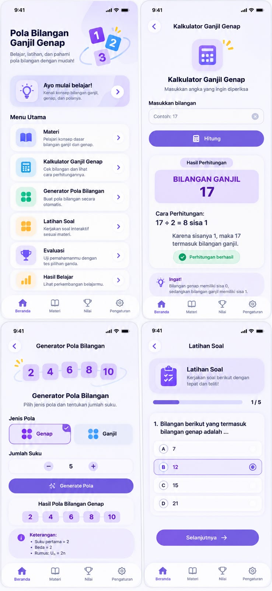

# PolaKu — Belajar Pola Bilangan Ganjil & Genap

**PolaKu** adalah aplikasi web pembelajaran matematika untuk siswa **SMP kelas VIII** pada materi **pola bilangan ganjil dan genap**. Aplikasi dirancang berdasarkan **Cognitive Load Theory (CLT)**: materi disajikan bertahap, singkat, dan visual. Tujuannya mengurangi beban kognitif siswa agar kemampuan **literasi matematika** mereka meningkat.

Aplikasi dibuat sebagai **PWA (Progressive Web App)**: bisa dibuka di browser HP maupun laptop, dan bisa **di-install ke layar utama HP tanpa Play Store/App Store**. Frontend ditulis dengan **JavaScript (React)**, backend dengan **Python (Flask)**.

## Identitas Proyek
| | |
|---|---|
| Nama | Suchita Rahma Fakhira |
| NIM | 2225250006 |
| Kelas | 3B — S1 Pendidikan Matematika |
| Mata Kuliah | Algoritma dan Pemrograman |
| Dosen Pengampu | Dr. Aan Hendrayana, S.Si., M.Pd. |

## Status Proyek
Pengembangan mengikuti model **ADDIE**.

| Tahap | Status | Keluaran |
|---|---|---|
| **A**nalysis | ✅ Selesai | Wawancara siswa → [docs/ANALISIS.md](docs/ANALISIS.md) |
| **D**esign | ✅ Selesai | PRD, arsitektur, desain, konten, mockup (lihat [Dokumen Perencanaan](#dokumen-perencanaan)) |
| **D**evelopment | 🔄 Berjalan | Backend Python (`backend/`) dan frontend JavaScript (`frontend/`) sudah dibuat; tinggal uji coba & deploy |
| **I**mplementation | ☐ | Uji coba dengan 3–5 siswa kelas VIII melalui HP |
| **E**valuation | ☐ | Analisis pre/post-test, angket beban kognitif, wawancara ulang |

## Latar Belakang
Wawancara dengan seorang siswa kelas VIII (4 November 2026) menemukan bahwa:
- Siswa **sering tertukar dan lupa rumus** pola ganjil (`Un = 2n − 1`) dan genap (`Un = 2n`).
- Soal dengan **angka besar** terasa sulit karena perkalian dan pengurangannya.
- Siswa **bingung mencari jumlah suku (Sn)**.
- Penjelasan guru kadang **terlalu cepat**, dan penjelasan yang **terlalu panjang** membuat bosan.
- Yang paling membantu: **contoh soal**, **tabel/gambar berwarna**, dan **latihan soal yang mirip**.

Detail lengkap: [docs/ANALISIS.md](docs/ANALISIS.md).

## Fitur Utama
- 📖 **Materi bertahap**: kenali ganjil & genap → rumus Un → contoh soal → jumlah suku (Sn). Satu konsep per layar, dan siswa sendiri yang menentukan kapan lanjut.
- 🧮 **Kalkulator Ganjil Genap**: memeriksa sebuah bilangan sekaligus menampilkan cara perhitungannya (mis. `17 ÷ 2 = 8 sisa 1`).
- 🔢 **Generator Pola Bilangan**: membuat deret ganjil/genap beserta keterangan suku pertama, beda, dan rumusnya.
- ✏️ **Latihan Soal**: soal acak dengan petunjuk bertahap dan umpan balik yang menjelaskan letak kesalahan.
- 🏆 **Evaluasi**: pre-test dan post-test pilihan ganda.
- 📊 **Hasil Belajar**: nilai dan progres belajar.
- 📲 **Bisa di-install & dipakai offline** tanpa Play Store/App Store.
- 👩‍🏫 **Rekap guru**: tabel nilai satu kelas yang bisa diunduh sebagai CSV.

**Rancangan tampilan (mockup):**



## Teknologi
| Bagian | Bahasa | Teknologi | Tugas |
|---|---|---|---|
| Frontend | **JavaScript** | React 18, Vite, vite-plugin-pwa, lucide-react | Tampilan, materi, Kalkulator, Generator, latihan & penilaian (bisa offline) |
| Backend | **Python** | Flask, SQLite, pytest | Data siswa, penyimpanan nilai, bank soal evaluasi, rekap guru & CSV |
| Hosting | – | PythonAnywhere (HTTPS) | Menyajikan aplikasi dan API dari satu alamat |

Penjelasan lengkap: [docs/ARSITEKTUR.md](docs/ARSITEKTUR.md).

## Struktur Folder
```
/
├─ README.md            # halaman ini
├─ CLAUDE.md            # panduan teknis untuk pengembang/AI asisten
├─ docs/                # dokumen perencanaan (Analysis & Design)
│  └─ mockup/           # gambar rancangan tampilan
├─ tools/buat_ikon.py   # Python — membuat ikon PWA
├─ frontend/            # JavaScript — React + Vite + PWA
└─ backend/             # Python — Flask + SQLite
```

## Cara Menjalankan
**Prasyarat:** Python 3.11+ dan Node.js 20+.

**1. Backend (Python)** — buka terminal di folder `backend/`:
```bash
python -m venv .venv
.venv\Scripts\activate            # Windows (macOS/Linux: source .venv/bin/activate)
pip install -r requirements-dev.txt
copy .env.example .env            # lalu isi SECRET_KEY dan KUNCI_GURU
flask --app app init-db           # membuat database
flask --app app run --debug       # berjalan di http://localhost:5000
```
Aplikasi terbuka untuk semua orang (tanpa kode kelas). Halaman rekap guru `http://localhost:5000/guru` dibuka dengan `KUNCI_GURU` dari file `.env`.

**2. Frontend (JavaScript)** — buka terminal kedua di folder `frontend/`:
```bash
npm install
npm run dev                       # buka http://localhost:5173
```

**3. Pengujian:** `pytest` (backend) dan `npm run test` (frontend).

**4. Versi produksi (satu server):** jalankan `npm run build` di `frontend/`, lalu cukup jalankan Flask — aplikasi lengkap (PWA + API + rekap guru) tersedia di `http://localhost:5000`.

## Cara Memasang di HP
Pemasangan membutuhkan alamat **HTTPS** hasil deploy (mis. `https://<nama-akun>.pythonanywhere.com`) — langkahnya ada di [docs/DEPLOY.md](docs/DEPLOY.md). Alamat ini akan dibagikan ke siswa dalam bentuk link atau QR code.

**Android (Chrome):**
1. Buka alamat PolaKu di Chrome.
2. Ketuk **"Pasang Sekarang"** di Beranda, atau menu ⋮ → **Instal aplikasi**.
3. Ikon PolaKu muncul di layar utama dan bisa dibuka seperti aplikasi biasa.

**iPhone (Safari):**
1. Buka alamat PolaKu di Safari.
2. Ketuk tombol **Bagikan** ⬆ → **Tambahkan ke Layar Utama** → **Tambah**.

Setelah terpasang, materi dan latihan tetap bisa dipakai **tanpa internet**. Nilai akan terkirim otomatis saat HP kembali online.

## Dokumen Perencanaan
| Dokumen | Isi |
|---|---|
| [docs/ANALISIS.md](docs/ANALISIS.md) | Hasil wawancara siswa (intrinsic, extraneous, germane load) dan implikasinya untuk desain |
| [docs/PRD.md](docs/PRD.md) | Kebutuhan produk: tujuan, persona, user story, fitur & prioritas, kriteria penerimaan |
| [docs/ARSITEKTUR.md](docs/ARSITEKTUR.md) | Arsitektur Python + JavaScript, database, API, PWA |
| [docs/DEPLOY.md](docs/DEPLOY.md) | Cara membuat aplikasi bisa diakses umum: link sementara (Cloudflare Tunnel) & permanen (PythonAnywhere) |
| [docs/DESAIN.md](docs/DESAIN.md) | Prinsip desain CLT, peta layar, wireframe, warna, font, komponen |
| [docs/KONTEN.md](docs/KONTEN.md) | Naskah materi, contoh soal, bank soal, katalog miskonsepsi, teks antarmuka |
| [docs/mockup/mockup-v1.jpg](docs/mockup/mockup-v1.jpg) | Rancangan tampilan aplikasi |
| [CLAUDE.md](CLAUDE.md) | Panduan teknis & aturan pengembangan |

## Rumus yang Dipakai
| | Genap | Ganjil |
|---|---|---|
| Barisan | 2, 4, 6, 8, … | 1, 3, 5, 7, … |
| Suku ke-n | `Un = 2n` | `Un = 2n − 1` |
| Jumlah n suku pertama | `Sn = n(n + 1)` | `Sn = n²` |

## Privasi
Aplikasi **terbuka untuk semua orang**: siswa cukup memasukkan **nama panggilan**, tanpa kode kelas, password, email, atau nomor HP. Yang dikirim ke server hanya nama panggilan dan hasil belajar. Rekap nilai hanya bisa dibuka guru/peneliti dengan kunci guru.

